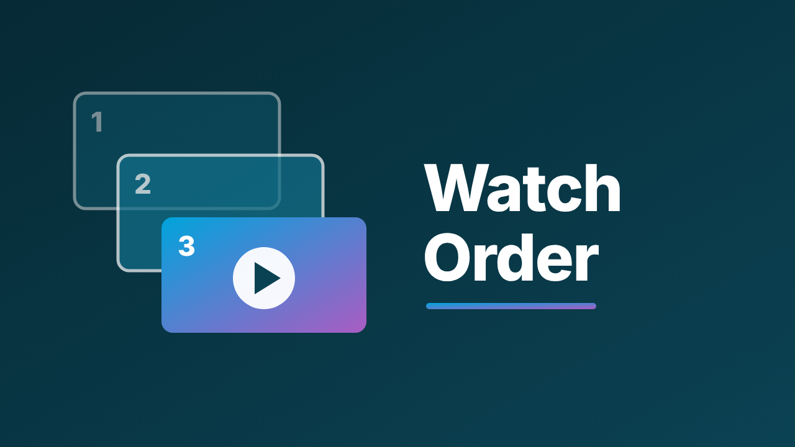
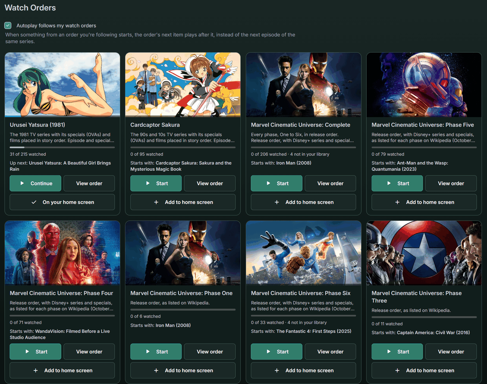
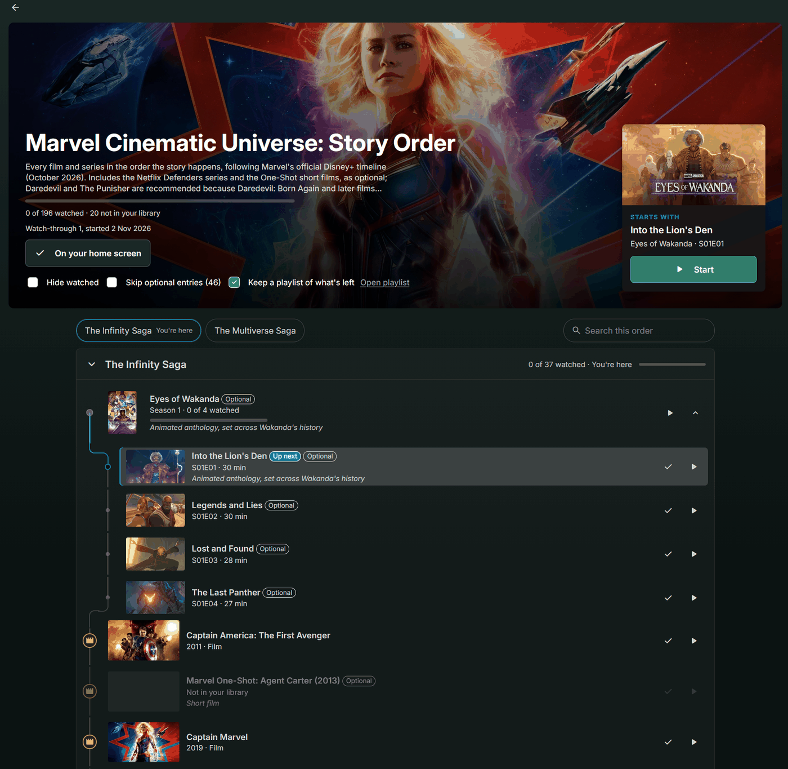
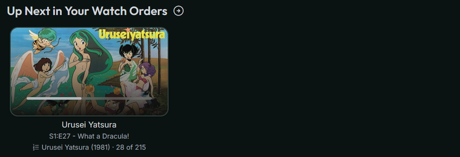
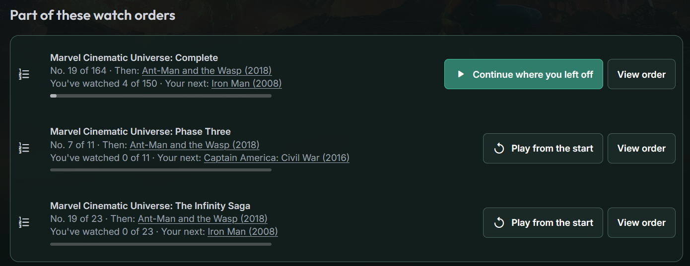
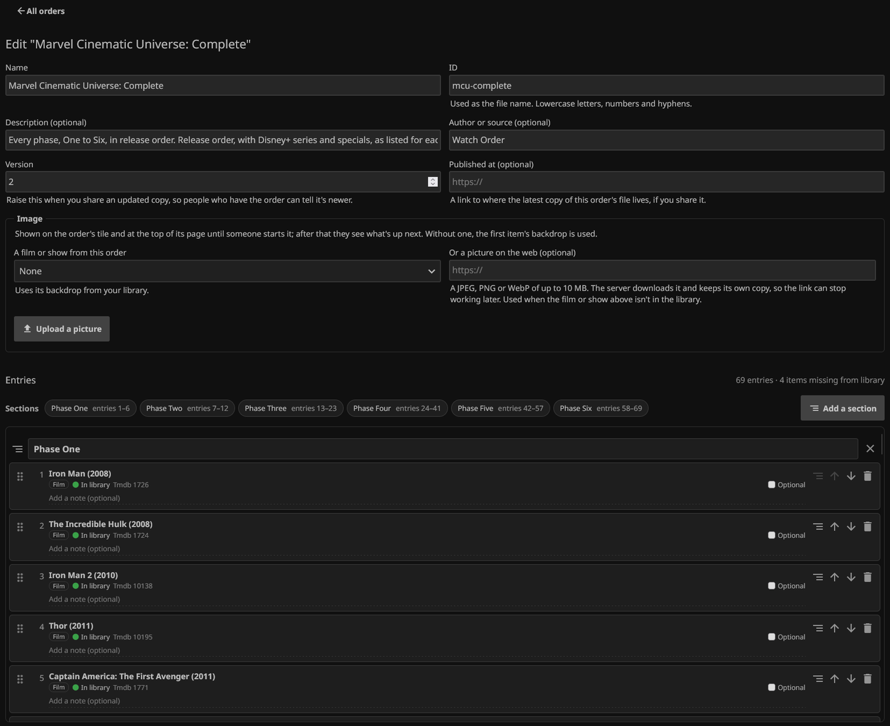
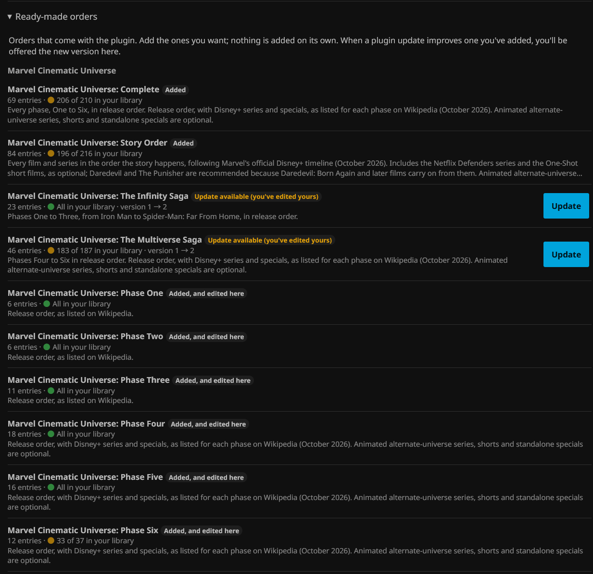

# Watch Order for Jellyfin



Watch films and episodes from across a franchise in one defined order: Star Wars with The Clone Wars woven in, the MCU in story order, Arrowverse crossovers. Each user's progress follows their normal Jellyfin played status, so they always know what's next.

## Screenshots


*The Watch Orders page in the web app.*


*An order's page, part-way through a watch-through.*


*"Up Next in Your Watch Orders" on the home screen.*


*On a film's page: the orders it's in, where, and what comes next.*


*Building an order in the Dashboard.*


*Ready-made orders, ready to add.*

These screenshots are from a server using the [ElegantFin](https://github.com/lscambo13/ElegantFin) theme. Watch Order is built from Jellyfin's own components, so it takes on whatever theme your server uses.

## Features

- **Watch orders page for everyone** in the web app: a **Watch Orders** entry in the library bar (or an icon next to the user menu, or both; set in the plugin settings) opens a Watch Orders page inside the app, like a library (with its own address, `#/watchorders`, so Back and refresh work). It shows each order with progress, "Continue" and "Play from here" (which queues the rest of the order), and watched toggles. Needs the [File Transformation](https://github.com/IAmParadox27/jellyfin-plugin-file-transformation) plugin.
- **"Up Next in Your Watch Orders" on the home screen**, just after Continue Watching: the next item in each order you're following, on Jellyfin's own cards (same as Next Up, with the watched, favourite and ⋯ buttons), plus the order's progress. Play starts it and queues the rest of the order. It's opt-in: an order appears once you add it, play from it on the Watch Orders page, or choose how to count what you'd already watched. Having watched some of it elsewhere isn't enough. Each user can add or remove orders themselves.
- **Visual order builder** in the Dashboard. Add films and episodes from your library, search TMDb/TVDb for titles you don't have yet, start from an existing collection, then drag to reorder. Each entry shows live whether it's in your library.
- **Mixed orders.** Films, single episodes, episode ranges and whole seasons from any number of series, in one list.
- **Library matching.** Matches by TMDb/IMDb/TVDb ids first, then by title and year, and shows exactly which items are missing.
- **Per-user progress.** Based on Jellyfin's own played flags: watch something anywhere and you move along the order. Respects each user's library access.
- **Watch-throughs.** If you've already watched some of an order (the films years ago, say), choose whether those count or start a fresh watch-through. **Start over** or **Watch again** begins a new one at any time, and the page shows which watch-through you're on and how many times you've finished. A fresh watch-through only counts what you watch after it began; nothing in your library is marked unwatched.
- **Optional entries.** Mark filler, spin-offs or side stories as optional in the builder. Each user chooses per order whether to skip them; skipped entries don't count towards progress and are never Up Next, queued or autoplayed.
- **Autoplay follows the order.** When something from an order you're following starts, the plugin queues the order's next item after it, so autoplay and "Up Next" play the film (or other series' episode) the order wants instead of the next episode of the same series. Never makes something autoplay that wouldn't have, and leaves re-watches of old items alone. It's on by default; each user can turn it off from their Watch Orders page (or the admin can make it opt-in, or off for everyone). Works in the web app and apps built on it, which report their queue and accept Jellyfin's "play next" command.
- **Playlists of what's left, for any app.** Each user gets a playlist ("Watch Order: …") of what they have left in each order they're following, in order and without the optional entries they skip. Watched items drop off as they finish, so pressing Play on it in any Jellyfin app (Android TV, iOS, Kodi and so on) carries on the order. It goes when they finish and comes back for a new watch-through. On by default for orders a user has taken up; each user can turn it off or on per order (deleting the playlist turns it off), and the admin can make it opt-in or off for everyone.
- **"Part of a watch order" on item pages.** A film's or episode's page in the web app shows which orders it's in, its place in each ("No. 12 of 160"), what the order plays after it, and your own progress, with **Continue where you left off** (your next item in the order, then the rest of it) or, if you haven't started or have finished, **Play from the start**, and **View order**. A series' or season's page shows how many entries from it each order has, with the same buttons.
- **Viewer stats for admins.** Each order in the Dashboard shows how many people are watching it, have finished or have yet to start, and **Viewers** opens a table of each user's progress, watch-through, next item and when they last watched something in it, flagging anyone stalled for a month.
- **Ready-made orders.** The MCU (complete, both sagas and each phase), Star Wars (the Skywalker Saga and the complete timeline) and anime (Cardcaptor Sakura, Urusei Yatsura) come with the plugin. Add the ones you want from the Dashboard, which shows how much of each is already in your library. Nothing is added on its own, and when a plugin update improves an order you've added, you're offered the new version (with a warning if you've edited yours).
- **Shareable files.** Orders are plain JSON with a schema, easy to keep in git and swap with others. Import them from files, a link (GitHub file pages and Gists work), or by pasting. Each order has its own version number, and fields from newer plugin versions are kept rather than dropped (see [Compatibility](docs/order-format.md#compatibility)).
- **Stays current.** Re-matches automatically after library changes (debounced) and on a daily scheduled task.

## Install

1. Dashboard → Plugins → Repositories → **+**, then add:
   `https://raw.githubusercontent.com/Verdancy-Rin/jellyfin-plugin-watch-order/main/manifest.json`
2. Catalog → **Watch Order** → Install, then restart Jellyfin.
3. Dashboard → **Watch Order** → add one from **Ready-made orders**, **New order** to build your own, or **Import** a file or link.
4. *(Recommended)* For the Watch Orders page, the home screen row and the section on item pages in the web app, add the repository `https://www.iamparadox.dev/jellyfin/plugins/manifest.json`, install **File Transformation**, and restart Jellyfin. Users then see **Watch Orders** in the web app's library bar (they may need to refresh the page once). Without it, orders still work through their playlists, autoplay and the API.

**Requires Jellyfin 12.1 or later.**

## Repository layout

```
.
├── src/Jellyfin.Plugin.WatchOrder/
│   ├── Plugin.cs                      Plugin entry point (name, GUID, config pages)
│   ├── PluginServiceRegistrator.cs    Dependency injection registration
│   ├── Api/
│   │   └── WatchOrderController.cs    REST API (/WatchOrder/...)
│   ├── Configuration/
│   │   ├── PluginConfiguration.cs     Server-wide settings
│   │   └── Web/configPage.{html,js}   Dashboard page: order list, builder, import, settings
│   ├── Models/                        Order definition, resolved order, user progress
│   ├── Parsing/
│   │   └── WatchOrderParser.cs        JSON parsing, validation, range expansion (no Jellyfin deps)
│   ├── Services/
│   │   ├── WatchOrderStore.cs         Reads and writes order files on disk
│   │   ├── WatchOrderResolver.cs      Matches entries to library items
│   │   ├── LibraryLookup.cs           The three library lookups the resolver makes (swapped for an in-memory library in tests)
│   │   ├── WatchOrderService.cs       In-memory cache of resolved orders
│   │   ├── WatchOrderProgressService.cs  Per-user played state and "next" item
│   │   ├── LibraryChangeListener.cs   Debounced re-match on library changes
│   │   ├── PlaylistSync.cs            Keeps each user's playlist of what's left
│   │   └── UserStateStore.cs          Per-user choices, watch-throughs and playlists (one JSON file per user)
│   ├── ScheduledTasks/
│   │   └── RefreshWatchOrdersTask.cs  Daily re-match (Dashboard → Scheduled Tasks)
│   └── WebClient/
│       ├── client.js                  User page (top-bar button, order list, order view, playback)
│       ├── ScriptInjector.cs          Adds client.js to the web app's index.html
│       └── FileTransformationRegistrar.cs  Registers the injector with File Transformation at startup
├── tests/Jellyfin.Plugin.WatchOrder.Tests/   xUnit tests (matching, progress, autoplay, playlists, stats, format); also validates every file in orders/
├── orders/                            Shareable order files (examples/ to start)
├── images/watch-order.{png,svg}    Plugin image for the Dashboard (SVG source uses the Inter font)
├── schema/watch-order.schema.json     JSON Schema for editor autocomplete
├── docs/order-format.md               Order file reference
├── build.yaml                         Plugin metadata (jprm-compatible)
├── manifest.json                      Plugin repository manifest, updated by the release workflow
└── .github/workflows/                 CI (build + test) and tag-triggered releases
```

## How it works

```
order JSON ──parse/validate──▶ WatchOrderDefinition
                                     │ expand ranges
                                     ▼
                              WatchOrderStep[] ──match against library──▶ ResolvedWatchOrder (cached, shared)
                                                                                │ + user's played flags
                                                                                ▼
                                                                           UserProgress (next item, x/y watched)
```

Orders are stored as files in `<jellyfin config>/plugins/configurations/WatchOrder/orders/`. You can also drop files there by hand, then run **Refresh watch orders** from Scheduled Tasks. Each user's choices (home screen, watch-throughs, playlists) are kept in `.../WatchOrder/users/`; watched progress itself always comes from Jellyfin.

## API

All routes need a signed-in user. Routes marked 🔒 need an administrator.

| Method | Route | Purpose |
| --- | --- | --- |
| GET | `/WatchOrder/Orders` | List orders |
| GET | `/WatchOrder/Orders/{id}` | Order with the current user's progress |
| GET | `/WatchOrder/Orders/{id}/Next` | Next item for the current user (204 when finished) |
| POST | `/WatchOrder/Orders/{id}/HomeState?state=Shown\|Hidden\|Default` | Add to or remove from the current user's home screen |
| POST | `/WatchOrder/Orders/{id}/Run?mode=Continue\|Fresh` | Keep counting what's already watched, or start a fresh watch-through (also "Start over") |
| POST | `/WatchOrder/Orders/{id}/Run/Undo` | Undo the last fresh start |
| POST | `/WatchOrder/Orders/{id}/SkipOptional?skip=true\|false` | Whether the current user skips optional entries in an order |
| POST | `/WatchOrder/Orders/{id}/Playlist?on=true\|false` | Whether the current user keeps a playlist of what's left in an order |
| GET | `/WatchOrder/Items/{itemId}/Orders` | The orders a film, episode, season or series is in, with its place and what comes after it |
| GET | `/WatchOrder/Stats` | Admin: each order's viewers and their progress |
| GET | `/WatchOrder/ReadyMade` | Admin: the orders bundled with the plugin, and whether each is added, edited or has an update |
| POST | `/WatchOrder/ReadyMade/{id}?replace=false` | Admin: add a ready-made order, or update it |
| GET | `/WatchOrder/Fetch?url=` | Admin: fetch an order file from a link, for importing |
| POST | `/WatchOrder/UserSettings?autoplayFollow=true\|false` | Whether autoplay follows the current user's watch orders |
| POST | `/WatchOrder/Orders/{id}/Items/{itemId}/Watched?watched=true\|false` | Mark an item watched or not; in a fresh watch-through, "not watched" only applies to that watch-through |
| GET | `/WatchOrder/ClientSettings` | Where the user page's button goes (used by the user page) |
| GET | `/WatchOrder/Progress` | Every order with the current user's progress (used by the user page) |
| GET 🔒 | `/WatchOrder/Orders/{id}/Resolved` | Match results, including missing items |
| GET 🔒 | `/WatchOrder/Orders/{id}/Definition` | Raw definition, for export |
| POST 🔒 | `/WatchOrder/Orders` | Import or replace an order |
| POST 🔒 | `/WatchOrder/Preview` | Match a draft against the library without saving (used by the builder) |
| DELETE 🔒 | `/WatchOrder/Orders/{id}` | Delete an order |
| POST 🔒 | `/WatchOrder/Refresh` | Re-match every order now |
| GET 🔒 | `/WatchOrder/WebClientStatus` | Whether the user page is active |
| GET (anonymous) | `/WatchOrder/ClientScript` | The user page script, loaded by the web app |

## Development

```bash
dotnet build -c Release
dotnet test
```

Needs the .NET 10 SDK. To try it on a server, copy `src/Jellyfin.Plugin.WatchOrder/bin/Release/net10.0/Jellyfin.Plugin.WatchOrder.dll` into
`<jellyfin config>/plugins/WatchOrder_1.0.0.0/` and restart Jellyfin.

The resolver's tests run against `InMemoryLibrary` (in the tests project), which follows Jellyfin 12.1's rules for the three lookups the resolver makes: provider ids match on exact name and value, names match on Jellyfin's "clean" form (no accents, lower case, punctuation as spaces), and missing episodes aren't returned. If a Jellyfin upgrade changes those rules, update `InMemoryLibrary` to match and the tests will show what it affects.

### Releasing

1. Set the new version in `build.yaml` and the `.csproj`, and replace `build.yaml`'s `changelog` with this release's notes.
2. Commit and push to `main`, and check CI passes.
3. Tag it: `git tag v1.2.3.4` then `git push origin v1.2.3.4`.

The Release workflow checks the version matches, runs the tests, builds the plugin, publishes a GitHub release with the zip and the notes, and adds the version to `manifest.json`, which is what Jellyfin's plugin catalogue reads.


## Roadmap

- [x] **Item pages** show the orders an item is in, with Play from here.
- [x] **Viewer stats** for admins.
- [x] **Playlists of what's left**, per user, kept up to date, so orders work in any Jellyfin app.
- [x] **Visual order builder** with library, metadata-provider and collection sources.
- [x] **User page** in the web app: browse orders, see progress, play the next item.
- [x] **Home screen row** with per-user choice of which orders appear.
- [x] **Watch-throughs**: count earlier viewing or start fresh, start over, re-watch counter.
- [x] **Autoplay follows the order**: when something in an order you're following starts, queue the order's next item after it.
- [x] **Import from a link**, and **ready-made orders** bundled with the plugin.
- [ ] Extra order sources (community indexes an admin can add, like plugin repositories). Not planned for now; anyone can share orders by link.
- [x] **Optional entries**, with a per-user, per-order choice to skip them.
- [x] **Resolver tests** against an in-memory library that follows Jellyfin's lookup rules.

## Contributing

Bug reports, fixes and new orders are welcome. See [CONTRIBUTING.md](CONTRIBUTING.md) for how, and what to expect. For questions, ideas, or to share an order you've made, use [Discussions](https://github.com/Verdancy-Rin/jellyfin-plugin-watch-order/discussions).

## How this was built

Watch Order was designed and tested by Verdancy and written with the help of Claude, Anthropic's AI assistant. Every feature was tried on a real Jellyfin server before release, and over 150 automated tests run on every change. All the code is here to read. If something looks wrong, please open an issue.

## Licence

Copyright (C) 2026 Verdancy.

Watch Order is free software, licensed under the [GNU General Public License v3.0](LICENSE), the licence Jellyfin recommends for plugins (they link against Jellyfin's own GPLv3 libraries). You can use, change and share it; if you share a changed version, share its source under the same licence. The order files in [`orders/`](orders/) are covered by the same licence.
